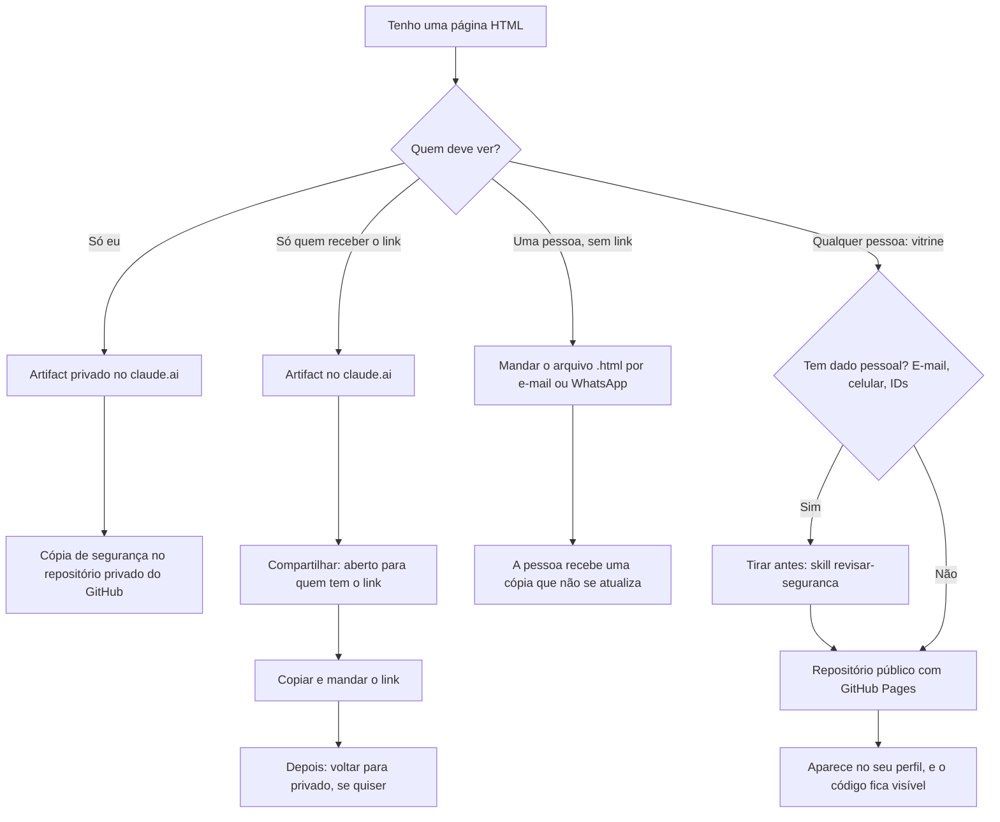

## Regras
- Repositório privado: gaveta. Guarda, não compartilha.
- Artifact: link. Cada página abre ou fecha separadamente.
- Repositório público: vitrine. Todo mundo que entra no seu perfil vê.
```
